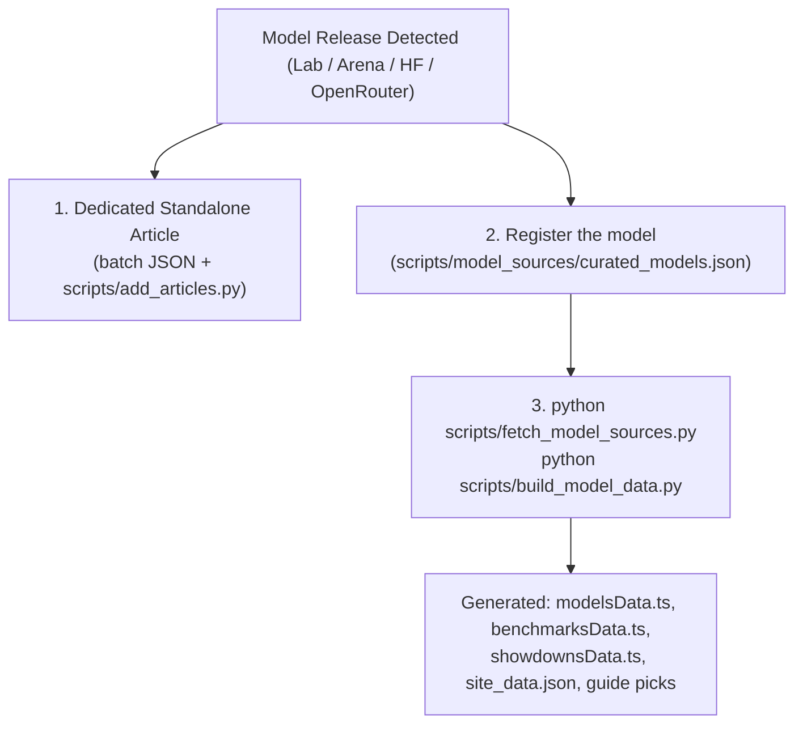

# NextVector Daily Intelligence Update Pipeline
**Standard Operating Procedure for Daily Autonomous Content & Newsletter Ingestion**

*Target Audience: AI Agents (Antigravity) & Editorial Operations*  
*Governing Rulebook: [NextVector Editorial & Publishing Rulebook](./EDITORIAL_RULEBOOK.md) (Strict Compliance Mandatory)*  
*Publication: NextVector (https://nextvector.rhasan.online) & The Morning Vector (https://nextvectorr.substack.com)*  
*Editor-in-Chief: Robiul Hasan*

---

> [!IMPORTANT]
> **NORMATIVE GOVERNANCE & RULEBOOK COMPLIANCE**:  
> This pipeline is strictly bound to and subordinated by the **[NextVector Editorial & Publishing Rulebook](./EDITORIAL_RULEBOOK.md)**.  
> Every AI agent, automated workflow, or editor executing this pipeline **MUST** comply with all editorial standards, verification procedures, media rules, and schemas established in the Rulebook. Under no circumstances may this pipeline bypass, weaken, or violate any section of the Rulebook.

---

## 0. Executive Overview & Trigger Command

Every day, the user will trigger the daily update by prompting the AI agent with:
> *"Run the daily update pipeline."* or *"Execute today's intelligence update."*

When receiving this trigger, the agent **MUST** execute the complete 7-stage workflow outlined below without skipping steps.

> [!IMPORTANT]
> **Runbook for agents**: the step-by-step checklist is `.agents/skills/daily-update/SKILL.md` (Antigravity loads it as the `daily-update` skill; `AGENTS.md` points to it). This document is the reference behind it. If the two disagree, the skill wins.
> **Tools**: `npm run harvest` (leads + model watch) → `pipeline_runs/YYYY-MM-DD.json` from `pipeline_runs/TEMPLATE.json` → `python scripts/add_articles.py <file> --check`, then without `--check` (writes articles, covers, briefing, ticker) → `npm run images` → `npm run build` → `npm run verify`.

### Core Objectives & Rulebook Alignment:
1. **At least 5 new intelligence reports** published to `src/data/articlesData.ts` covering verifiable developments from the **last 48 hours**, rigorously structured using the **Three-Question Framework** ([Rulebook §2](./EDITORIAL_RULEBOOK.md#2-the-three-question-analytical-framework)).
2. **Mandatory Zero-Miss AI Model & Benchmark Synchronization**: If ANY new frontier or open-weights model, checkpoint, canary drop, or API tier was released or updated in the last 72 hours:
   - Create a dedicated standalone news article in `src/data/articlesData.ts`.
   - Add the model to `scripts/model_sources/curated_models.json` (exact arena.ai / OpenRouter / OSWorld / SWE-bench keys, official price override only from a lab price page). Never hand-edit `src/data/modelsData.ts`, `benchmarksData.ts` or `showdownsData.ts`: they are generated.
   - Run `python scripts/fetch_model_sources.py` then `python scripts/build_model_data.py`. Leaderboards, comparisons and the decision guide rebuild from data.
   - Artificial Analysis needs `AA_API_KEY=...` in `.env.local` (git-ignored; free key, 100 requests/day). Without it that source is skipped and the old snapshot stays. For a new model, find its slugs in the local `snapshots/artificial_analysis_full.json` and add them as `"aa": [...]` in `curated_models.json` (list every setting; the build uses the best one). Keep the credit to artificialanalysis.ai visible (footer, board source line, model page).
3. **100% Factuality & Zero Hallucination**: No fabricated specs, parameters, or DOIs ([Rulebook §3.1](./EDITORIAL_RULEBOOK.md#31-strict-factuality-zero-hallucination-policy)).
4. **100% Unique, Non-Generic Images**: Exactly **0 duplicate images** across the entire publication. Tier-1 public domain, Tier-2 bespoke technical diagrams, or Tier-3 verified URLs ([Rulebook §4](./EDITORIAL_RULEBOOK.md#4-visual-assets--media-standards-strict-compliance)).
5. **Sole Authorship by Robiul Hasan**: Every report authored by Founder & Editor-in-Chief Robiul Hasan ([Rulebook §6.1](./EDITORIAL_RULEBOOK.md#61-sole-authorship)).
6. **Update Daily Briefing**: Refresh `MOCK_DAILY_BRIEFING` in `src/data/mockData.ts` for today's date.
7. **Timeline Milestone Audit & Sync**: Evaluate today's intelligence reports against the Breakthrough Timeline threshold (Impact Score >= 95 or historic structural shifts). Append qualifying events to `MOCK_TIMELINE_EVENTS` in `src/data/mockData.ts` with cross-links to the full report ([Rulebook §8](./EDITORIAL_RULEBOOK.md#8-technology--science-breakthrough-timeline-curation)).
8. **Live Breaking Signal Ticker Update**: Refresh `MOCK_LIVE_SIGNALS` in `src/data/mockData.ts` with 5 punchy entity-action ticker items corresponding to today's breakthroughs, ensuring the homepage live ticker stays completely current and deep-linked ([Rulebook §9](./EDITORIAL_RULEBOOK.md#9-live-breaking-signal-ticker-standards)).
9. **Pass Pre-Publication Release Gate**: `npm run build` must compile with 0 errors, and pass all steps of the **Release Gate** ([Rulebook §7](./EDITORIAL_RULEBOOK.md#7-pre-publication-quality-assurance-release-gate)) before pushing to `main`.
10. **Generate Substack Newsletter**: Draft the full edition of **The Morning Vector** ready to copy/paste into Substack ([Rulebook §6.2](./EDITORIAL_RULEBOOK.md#62-newsletter--syndication-integration)).

---

---

## Stage 1: State Audit & Temporal Grounding

Before touching any code or searching the web, anchor the operational timeline, determine the current catalog baseline, and enforce the **Anti-Duplication Protocol** ([Rulebook §3.3](./EDITORIAL_RULEBOOK.md#33-anti-duplication-protocol)) and **Temporal Consistency Standards** ([Rulebook §3.4](./EDITORIAL_RULEBOOK.md#34-temporal-consistency--zero-anachronism-standards)):

1. **Step 0: Operational Clock & System Date Anchor (Mandatory Grounding)**:
   - The agent **MUST** explicitly run the date check command to ground itself in the real-world operational date:
     ```bash
     python -c "from datetime import datetime, timezone; print(datetime.now(timezone.utc).strftime('%Y-%m-%d %H:%M:%S UTC'))"
     ```
   - **Define the 48-Hour Breaking Window**: The discovery window is strictly `[Current Time - 48 Hours, Current Time]`.
   - **Zero-Anachronism Directive**: The agent must NEVER treat past-year models (such as Claude 3.7 Sonnet released in February 2025, Claude 3.5 Sonnet released in 2024, or GPT-4o) as breaking news.
2. **Existing Articles**:
   Search `src/data/articlesData.ts` for each candidate topic to avoid repeats. Do not pick article IDs yourself: `scripts/add_articles.py` assigns the next `art-N` and rejects duplicate slugs, titles and cover photos.
3. **Check Tracked Models**:
   Inspect `scripts/model_sources/curated_models.json` (the model list) and the snapshot dates in `scripts/model_sources/snapshots/`. Gate 6 fails when a snapshot is over 30 days old.

---

## Stage 2: Intelligence Discovery & Sourcing Hierarchy (Last 48 Hours)

### 2.0 Mandatory Live-Feed Ingestion (Zero-Memory Reliance Protocol)
> [!CAUTION]
> **PROHIBITION OF PARAMETRIC MEMORY RELIANCE**:  
> Agents are strictly forbidden from drafting stories or announcing model releases based on unanchored pre-training memory. Every single candidate story **MUST** originate from live external feeds harvested in real time.

Execute the automated harvester tool to gather verified live candidate stories from the last 48 hours:
```bash
npm run harvest
# or: python scripts/fetch_live_intel.py
```
This automatically queries, prints every item grouped by source, and saves `pipeline_runs/harvest-YYYY-MM-DD.json`:
1. **Hacker News (Algolia API)**: stories with 30+ points from the last 48 hours, most points first.
2. **BBC Technology RSS**: items from the last 48 hours.
3. **arXiv cs.AI / cs.CL / cs.LG**: the 30 newest submissions.
4. **Model watch, OpenRouter**: models added in the last 72 hours, plus any model from the last 14 days that is not in `curated_models.json` (marked NEW).
5. **Model watch, Hugging Face**: uploads from major lab organisations in the last 72 hours.

A harvest item is a lead, not a fact: open the primary source before writing.

Inspect the harvested signals. Every candidate story must have:
- A verifiable primary URL.
- A verified publication timestamp matching the 48-hour window.

### 2.1 Multi-Beat Sourcing Hierarchy
Search reputable primary sources adhering to the **Primary Sourcing Hierarchy** ([Rulebook §3.2](./EDITORIAL_RULEBOOK.md#32-primary-sourcing-hierarchy)) across four distinct beats:

| Beat | Primary Sources to Query | Focus Areas |
| :--- | :--- | :--- |
| **1. Frontier AI & Reasoning (Zero-Miss Model Watch)** | OpenAI, DeepMind, Anthropic, Meta AI, Mistral, xAI, DeepSeek, Qwen/Alibaba, Microsoft Research, Hugging Face Hub (Trending & New Models), LMSYS Chatbot Arena (Canary models & new battle slots), OpenRouter & Fireworks API catalogs, arXiv (cs.AI, cs.CL, cs.LG), and Lab Technical GitHub repos | New architecture drops, MoE/MLA breakthroughs, canary API releases, quantized open weights, test-time compute, KV cache compression, multi-agent frameworks. |
| **2. Silicon & Infrastructure** | TSMC, ASML, NVIDIA, AMD, Cerebras, Intel Labs, SK Hynix, Micron, Hyperscale Cloud | Wafer yields, advanced packaging (CoWoS, HBM3E/4), High-NA EUV, liquid-cooled rack architectures. |
| **3. Systems & Cybersecurity** | Linux Foundation, CISA, US-CERT, PyTorch, Kubernetes, GitHub Security, kernel trees | Mainline kernel merges, zero-days, supply chain exploits, BGP hijacking, memory safety migrations. |
| **4. Applied Science & Space** | NASA, ESA, STScI (Webb), ESO, NIST, Nature, Science, NEJM, APS Physics | Space telescope cosmic dawn discoveries, quantum sensors, fusion magnets, in-vivo CRISPR, solid-state batteries. |

### Selection Criteria (Top 5+ Stories):
- Filter for **substantive technical depth**, not generic corporate PR or minor executive personnel moves.
- Minimum **5 distinct reports**. If more high-signal events occurred, there is no upper limit.
- Calculate a **Signal Score** (70–100) based on architectural novelty and empirical impact.

### Factuality Verification Rules ([Rulebook §3.1](./EDITORIAL_RULEBOOK.md#31-strict-factuality-zero-hallucination-policy)):
- **Zero Inventions**: Verify exact model parameters, latency numbers, benchmark results, wafer nanometer nodes, or court dockets from primary documentation.
- If a technical metric is unconfirmed, state *"according to developer technical documentation"* or omit.

---

## Stage 3: Zero-Miss AI Model Release & 4-Way Synchronization

Perform an exhaustive, multi-source sweep to answer: **Were any AI models, checkpoints, canary previews, or API weights released in the last 72 hours?**

### 3.1 Multi-Source Discovery Channels (Zero-Miss Protocol)
Never rely on arXiv preprints alone. Many labs (such as DeepSeek, Mistral, Alibaba/Qwen, or Meta) drop weights, API endpoints, or LMSYS arena battle slots days before submitting formal papers. The daily sweep **MUST** explicitly audit:
1. **Arena (`arena.ai/leaderboard/text`, formerly LMSYS)**: Check newly ranked models and updated leaderboard rankings. The harvester's MODEL WATCH section lists new OpenRouter and Hugging Face entries.
2. **Hugging Face Model Hub (`huggingface.co/models?sort=createdAt`)**: Scan newly uploaded weights from verified lab organizations (`deepseek-ai`, `meta-llama`, `mistralai`, `Qwen`, `google`, `microsoft`).
3. **API Aggregators & Router Providers**: Audit **OpenRouter** (`openrouter.ai/models`) and **Fireworks AI** (`fireworks.ai/models`) for newly hosted model IDs, pricing tiers, and context length support.
4. **Lab GitHub Repositories & Release Tags**: Inspect `github.com/deepseek-ai`, `github.com/vllm-project/vllm`, `github.com/sgl-project/sglang`, and official lab blogs.

---

### 3.2 Mandatory 4-Way Synchronization Workflow
Whenever a new model or major checkpoint is detected, the agent **MUST** execute all four synchronization steps without omission:



#### Step 1: Standalone News Report (batch JSON → `scripts/add_articles.py`)
- The model release **MUST** be treated as a dedicated standalone news article (never just a bullet point in a briefing).
- Rigorously apply the **Three-Question Framework**:
  - **What Happened**: Exact parameter counts (total vs. active for MoE), architecture changes (e.g. MLA-2, MTP, RoPE theta, FP8/FP4 training), context window, and benchmark numbers.
  - **Why It Matters**: Cost per million tokens, inference hardware requirements (e.g. VRAM footprint, KV cache compression), and competitive positioning against OpenAI/Anthropic/Google flagships.
  - **What Could Happen Next**: Impact on open-weights ecosystem, self-hosting economics, and enterprise displacement over the next 6–18 months.
- Use a unique, on-topic cover image (see Stage 4). Never invent architecture details, parameter counts or scores that the lab did not publish.

#### Step 2: Register the Model (`scripts/model_sources/curated_models.json`)
- Add one entry: `id`, `name`, `dev`, and the exact source keys that exist today:
  - `arena`: the `modelDisplayName` on https://arena.ai/leaderboard/text (pick the setting you want shown, e.g. `-high`).
  - `or`: the OpenRouter model id (https://openrouter.ai/api/v1/models).
  - `osw` / `swe`: only if the model has a "General model" row on OSWorld-Verified or a mini-SWE-agent row on swebench.com.
  - `price`: only when the lab publishes an official price page (`src`: `anthropic` or `google`, or add the page to `PRICE_SOURCES` in `build_model_data.py`). Otherwise the OpenRouter price is used.
  - `params`: only with a source (`paramsSrc` URL, or `name` when the size is in the official model name).
- A model needs at least one source (Arena, OpenRouter or official price). Unsourced models are rejected by the build.
- **PROHIBITED**: typing scores, prices, dates or parameter counts by hand without a source; formula-based values of any kind.

#### Step 3: Refresh Sources and Rebuild
```bash
python scripts/fetch_model_sources.py
python scripts/build_model_data.py
```
- The build writes `src/data/modelsData.ts`, `src/data/benchmarksData.ts`, `src/data/showdownsData.ts`, `scripts/model_sources/build/site_data.json`, and model-page redirects in `vercel.json`.
- Boards: Arena (real arena.ai ranks), OSWorld-Verified (General model runs), SWE-bench Verified (mini-SWE-agent bash-only runs), and the Price vs Arena Pareto frontier (blended price = (3 × input + output) / 4).
- The build fails loudly if a curated key is not found in the snapshots. Fix the key; do not guess.

#### Step 4: Comparisons and Decision Guide
- Head-to-head pages (`showdowns` in `curated_models.json`) and decision-guide picks are computed from the data. Change a pair by editing the JSON; never write comparison claims by hand.

---

### If NO new model was released:
- Explicitly confirm in the execution notes that LMSYS Arena, Hugging Face, OpenRouter, and lab repositories were verified with zero new drops in the last 72 hours, and proceed to general intelligence beats.

---

## Stage 4: Visual Asset Curation & Deduplication

Enforce the strict **Visual Asset Rules** ([Rulebook §4](./EDITORIAL_RULEBOOK.md#4-visual-assets--media-standards-strict-compliance)):

1. **Rule of Absolute Uniqueness (Zero Duplication)** ([Rulebook §4.1](./EDITORIAL_RULEBOOK.md#41-rule-of-absolute-uniqueness-zero-duplication)):
   - Every single new article must have a **completely unique cover image**.
   - Cross-check proposed image URL/path against all existing articles. No duplicates allowed!
2. **Anti-Generic Policy** ([Rulebook §4.2](./EDITORIAL_RULEBOOK.md#42-anti-generic-image-policy)):
   - Strictly banned: generic matrix code, glowing padlocks on laptops, blue abstract motherboard lines, generic stock handshakes.
3. **Sourcing Priority** ([Rulebook §4.3](./EDITORIAL_RULEBOOK.md#43-asset-sourcing--selection-hierarchy)):
   - **Tier 1 (Public Domain NASA/ESO/Science)**: Download to `public/images/articles/art-{id}-{slug}.jpg`.
   - **Tier 2 (Bespoke Technical Diagrams)**: Use image generation for novel AI architectures/exploits with Swiss typography and clean schematics. Save to `public/images/articles/art-{id}-{slug}.jpg`.
   - **Tier 3 (Verified Topic Photography)**: Unsplash image URL (`https://images.unsplash.com/photo-...`) in the batch JSON. `scripts/add_articles.py` downloads it to `public/images/articles/art-N-<slug>.jpg`, checks it is at least 800px wide, and rejects a photo that is already used (exact copy or the same photo at another size/crop). New articles must not hotlink remote covers; Gate 1 fails if they do.
4. **Mandatory Descriptive Alt Text** ([Rulebook §4.4](./EDITORIAL_RULEBOOK.md#44-mandatory-descriptive-alt-text-coverimagealt)):
   - Write rich, descriptive `coverImageAlt` explaining the visual mechanics and technical context.
5. **Strict Prohibition of Programmatic Text/Slide Infographics**:
   - Agents are **strictly forbidden** from generating 2D Pillow/PIL slide graphics, flowchart boxes, or text-heavy infographics with bullet points as article cover images.
   - Cover images must always be **clean, atmospheric, high-resolution photography** (cleanrooms, hardware setups, astronomical observatories, biochemical testbeds, or photorealistic renders). Text and summaries belong in the website layout, never drawn across the hero image!

---

## Stage 5: Codebase Content Injection

### 5.1 Write the Daily Batch File
Copy `pipeline_runs/TEMPLATE.json` to `pipeline_runs/YYYY-MM-DD.json` and fill it. The field names are the real `Article` type in `src/types/index.ts`:
- `slug` (kebab-case, unique), `title`, `subtitle` (one sentence)
- `category`: `'ai'` | `'technology'` | `'science'` | `'research'`
- `articleType`: `breaking` | `analysis` | `deep-dive` | `model-report` | `benchmark-report` | `research-explained` | `discovery` | `industry-watch`
- `signalRating`: 70–100 · `publishedAt`: ISO UTC with `Z`, not in the future · `readTimeMinutes`: number
- `coverImage` (Unsplash/NASA URL or existing local path) + `coverImageAlt`
- `tags`: 5 or more · `keyTakeaways`: 3 or more
- `threeQuestions`: `whatHappened`, `whyItMatters`, `whatsNext` (each > 80 characters)
- `content`: **array of paragraph strings**. Length follows the sources (usually 400–1,200 words); never pad with unsourced detail. It must NOT restate the `threeQuestions` answers in other words: every paragraph adds facts, figures, mechanisms or sources the Triad does not have ([Rulebook §2.4](./EDITORIAL_RULEBOOK.md#24-no-restating-rule-triad-vs-article-body)).
- `technicalSpecs` (optional, string → string), `citations`: `[{ title, url, source }]` with primary URLs you opened
- `relatedModelId` (optional, must exist), `isHero: true` on exactly one lead story, `isFeatured` optional
- Do not set `id` or `author`: the script assigns `art-N` and `AUTHOR_ROBIUL_HASAN`.

Then run `python scripts/add_articles.py pipeline_runs/YYYY-MM-DD.json --check` until it passes, and once more without `--check` to write. Never paste article objects into the 1.4 MB `articlesData.ts` by hand.

### 5.2 Daily Briefing (`MOCK_DAILY_BRIEFING`) — in the same batch file
- `briefing.date`: today, e.g. `Monday, October 12, 2026` (Gate 2 warns if it does not match the newest article date).
- `briefing.summary`: 2-sentence macro synthesis of today's top developments.
- `briefing.items`: exactly 5 items, each `headline`, `category`, `urgency` (`'Critical Signal'` | `'High Impact'` | `'Notable Shift'`), `summary` (2 sentences), `whyItMatters` (1 sentence), `articleSlug`. The script numbers them `brief-1`..`brief-5`.

### 5.3 Breakthrough Timeline Synchronization (`MOCK_TIMELINE_EVENTS` in `src/data/mockData.ts`)
Audit each of today's 5+ stories against the permanent timeline criteria ([Rulebook §8](./EDITORIAL_RULEBOOK.md#8-technology--science-breakthrough-timeline-curation)):
- **Qualification Threshold**: Impact Score >= 95, or historic industry shifts (e.g. major tech acquisitions, first-in-kind architecture reveals, physical semiconductor yield validations, cosmic paradigm shifts).
- **Update Action**:
  - Insert new `TimelineEvent` items at the top of `MOCK_TIMELINE_EVENTS` in reverse-chronological order:
    - `id`: `time-YYYY-MM-DD[-suffix]`
    - `year`: current year (number, e.g. `2026`)
    - `month`: short date (e.g. `'Sep 9'`)
    - `title`: definitive technical headline
    - `category`: must match one of the 5 canonical categories:
      - `'AI Breakthrough'`
      - `'Semiconductors'`
      - `'Computing Architecture'`
      - `'Fundamental Science'`
      - `'Space & Quantum'`
    - `summary`: 1-2 sentence executive synopsis
    - `impactScore`: 95–100
    - `keyShift`: single-sentence description of the permanent technical/structural inflection point
    - `articleSlug`: exact slug of the corresponding NextVector report for seamless cross-linking

### 5.4 Live Breaking Signal Ticker (`MOCK_LIVE_SIGNALS`) — in the same batch file
The homepage ticker (label `Breaking`) must show today's stories ([Rulebook §9](./EDITORIAL_RULEBOOK.md#9-live-breaking-signal-ticker-standards)). In the batch file, `signals` holds exactly 5 items:
- `tag`: 1–4 word entity or event label (e.g. `'ASML & Intel'`, `'CISA Directive'`)
- `text`: one factual sentence, 95 characters or fewer
- `articleSlug`: slug of today's matching report

The script numbers them `sig-1`..`sig-5` and replaces the old list.

---

## Stage 6: Verification, Build & Deployment Gate

Execute the mandatory **8-Step Pre-Publication Release Gate** ([Rulebook §7](./EDITORIAL_RULEBOOK.md#7-pre-publication-quality-assurance-release-gate)):

1. **Step 1: Factuality & Primary Source Audit**: Verify claims, numbers, and DOIs. Also run the No-Restating self-check ([Rulebook §2.4](./EDITORIAL_RULEBOOK.md#24-no-restating-rule-triad-vs-article-body)): no body paragraph may only repeat the Triad.
2. **Step 2: Temporal Sanity & Zero-Anachronism Audit**:
   - Verify that all newly drafted stories originate from the **last 48 hours**.
   - Enforce the ban on legacy models: ensure no 2024/2025 models (e.g., Claude 3.5, Claude 3.7 Sonnet, GPT-4o) are described as breaking new releases.
3. **Step 3: Catalog Deduplication Check**: Confirm title, slug, and topic uniqueness.
4. **Step 4: Timeline Integrity Check**: Confirm whether any of today's reports meet the Breakthrough Timeline threshold (Impact Score >= 95) and that `MOCK_TIMELINE_EVENTS` is updated, categorized correctly, and sorted reverse-chronologically with `articleSlug` links.
5. **Step 5: Live Signal Ticker Integrity Check**: Confirm that `MOCK_LIVE_SIGNALS` in `src/data/mockData.ts` contains 5 fresh signals matching today's stories with valid `articleSlug` links.
6. **Step 6: AI Model, Benchmark & Decision Matrix Synchronization Audit**: Confirm that whenever a new AI model, checkpoint, or canary drop is released or analyzed:
   - Dedicated standalone report published in `src/data/articlesData.ts`.
   - Added to `scripts/model_sources/curated_models.json` with real source keys, snapshots refreshed, and `python scripts/build_model_data.py` run (Gate 6 checks the build).
7. **Step 7: Automated Release Gate & Build Verification**:
   Compress any new cover images, run the production build (it regenerates `public/sitemap.xml`, `public/rss.xml` and `public/llms-full.txt` from the data files), then the verifier:
   ```bash
   npm run images
   npm run build
   npm run verify
   ```
   - `npm run images` shrinks covers over 250 KB (max 1600px wide, JPEG q82) and converts opaque PNGs to JPEG, updating paths in `articlesData.ts`. Re-running it is safe.
   - Never hand-edit `public/sitemap.xml` or `public/rss.xml`; the build owns them.
   - `npm run verify` (`python scripts/verify_daily_pipeline.py`) validates:
     - 0 duplicate images across the entire catalog.
     - All local image assets exist in `public/images/articles/`.
     - 100% deep-link synchronization between articles, briefing, signals, and timeline.
     - Temporal sanity (valid ISO dates, zero historical anachronisms).
     - Full sitemap coverage for all published slugs.
     - Every `relatedModelId` / `relatedBenchmarkId` / `relatedPaperId` points to a real record.
     - New articles (after art-221): local cover only, author `AUTHOR_ROBIUL_HASAN`, no future `publishedAt`, no near-duplicate cover photo; briefing has 5 items; ticker texts ≤ 95 characters.
   - `npm run build` (`tsc -b && vite build && prerender`) must compile with 0 TypeScript/JSX errors.
8. **Step 8: Atomic Git Commit & Remote Push**:
   Stage modified and new files:
   ```bash
   git status
   git add src/data public/images/articles public/sitemap.xml public/rss.xml public/llms.txt public/llms-full.txt public/ai-summary.json scripts/model_sources vercel.json newsletters
   git commit -m "feat(intelligence): daily briefing and articles update [YYYY-MM-DD]"
   git push origin main
   ```
   Never stage `.env.local` or `pipeline_runs/` (both git-ignored).

---

## Stage 7: Substack Newsletter Generation (The Morning Vector)

Once the website is updated and live, compile the complete Substack newsletter edition adhering to the syndication standard ([Rulebook §6.2](./EDITORIAL_RULEBOOK.md#62-newsletter--syndication-integration)).

Save the newsletter draft to:
`newsletters/YYYY-MM-DD-the-morning-vector.md`

### Substack Newsletter Template:

```markdown
---
subject: "The Morning Vector: [Top Story Headline in 6-8 words]"
subtitle: "[1-sentence teaser of today's 2 biggest technical revelations]"
date: "[Full Date, e.g. September 9, 2026]"
author: "Robiul Hasan"
publication: "The Morning Vector by NextVector"
---

# THE MORNING VECTOR
### The 3-Minute Executive Signal Briefing | [Date]
*Delivered by NextVector Intelligence • Filter the noise.*

---

## ⚡ EXECUTIVE MACRO SCAN
> [2-3 sentences synthesizing today's macro shift across AI, compute infrastructure, and applied science.]

---

## 🔴 LEAD INTELLIGENCE REPORT
### [Title of Top Story (art-XX)]
**Signal Purity Score: [XX]/100 • Critical Breakthrough**

[3-4 paragraphs deconstructing the lead breakthrough.]

- **What Happened:** [Factual summary with numbers, versions, specs]
- **Why It Matters:** [Architectural and economic implications]
- **What Could Happen Next:** [Second-order projections for the next 6-12 months]

👉 **[Read the Full Technical Report on NextVector ↗](https://nextvector.rhasan.online/article/[slug])**

---

## 🛰️ RAPID SIGNAL SCANS (Last 48 Hours)

### 1. [Story #2 Headline]
- **Category:** [AI / Technology / Science] • **Read:** [X] min
- **The Core Signal:** [2-sentence technical summary.]
- **Bottom Line:** [Why engineering leaders must track this.]
- 🔗 [Read Full Signal on NextVector ↗](https://nextvector.rhasan.online/article/[slug])

### 2. [Story #3 Headline]
- **Category:** [AI / Technology / Science] • **Read:** [X] min
- **The Core Signal:** [2-sentence technical summary.]
- **Bottom Line:** [Why engineering leaders must track this.]
- 🔗 [Read Full Signal on NextVector ↗](https://nextvector.rhasan.online/article/[slug])

### 3. [Story #4 Headline]
- **Category:** [AI / Technology / Science] • **Read:** [X] min
- **The Core Signal:** [2-sentence technical summary.]
- **Bottom Line:** [Why engineering leaders must track this.]
- 🔗 [Read Full Signal on NextVector ↗](https://nextvector.rhasan.online/article/[slug])

### 4. [Story #5 Headline]
- **Category:** [AI / Technology / Science] • **Read:** [X] min
- **The Core Signal:** [2-sentence technical summary.]
- **Bottom Line:** [Why engineering leaders must track this.]
- 🔗 [Read Full Signal on NextVector ↗](https://nextvector.rhasan.online/article/[slug])

---

## 📊 MODEL & BENCHMARK RADAR
*(If any model was released/updated today)*
- **Model:** [Name] by [Developer]
- **Key Metric:** [Elo / SWE-bench / Context / Pricing]
- **NextVector Analysis:** [1-sentence verdict]
👉 **[Inspect Live Benchmark Radar ↗](https://nextvector.rhasan.online/benchmarks)**

---

**NextVector Intelligence**  
*Curated & Founded by [Robiul Hasan](https://nextvector.rhasan.online/author) (Dhaka).*  
*Primary Source Verified • Zero Clickbait Guarantee.*  
*Manage your subscription or read past archives at [nextvectorr.substack.com](https://nextvectorr.substack.com).*
```

Output this entire newsletter markdown in the chat for the user so they can immediately paste it into their Substack post composer!

---

*End of Daily Update Pipeline. Governed by [EDITORIAL_RULEBOOK.md](./EDITORIAL_RULEBOOK.md).*
